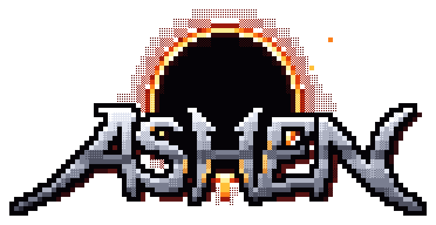
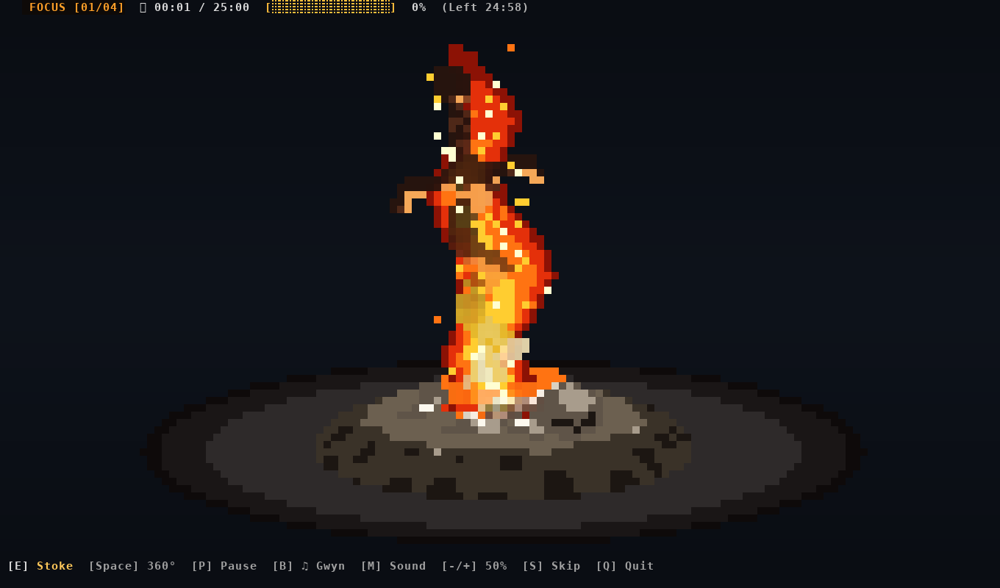
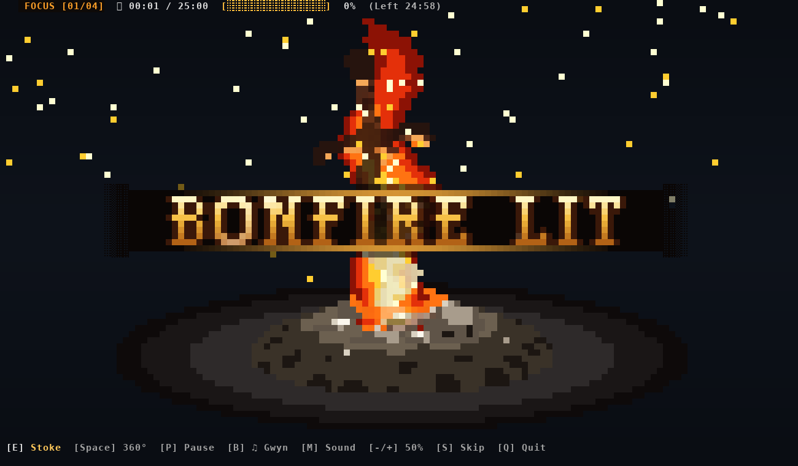
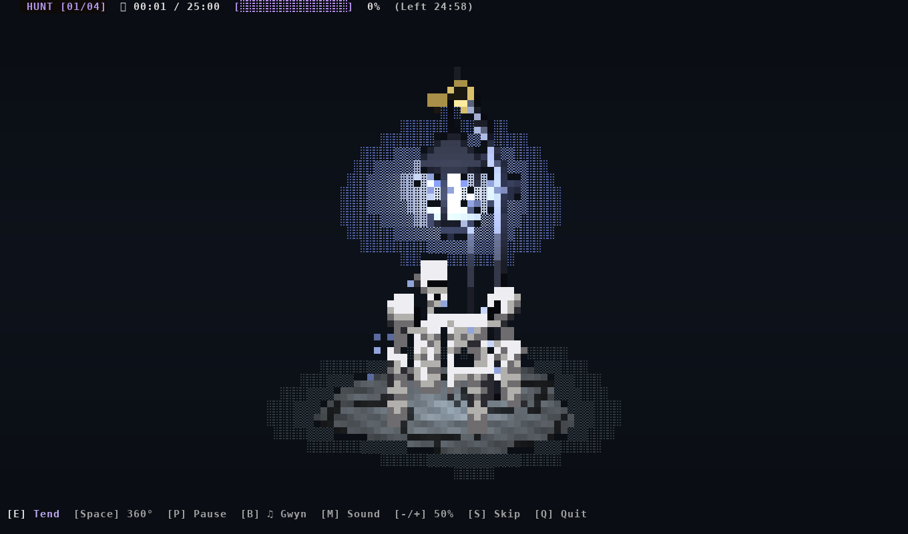
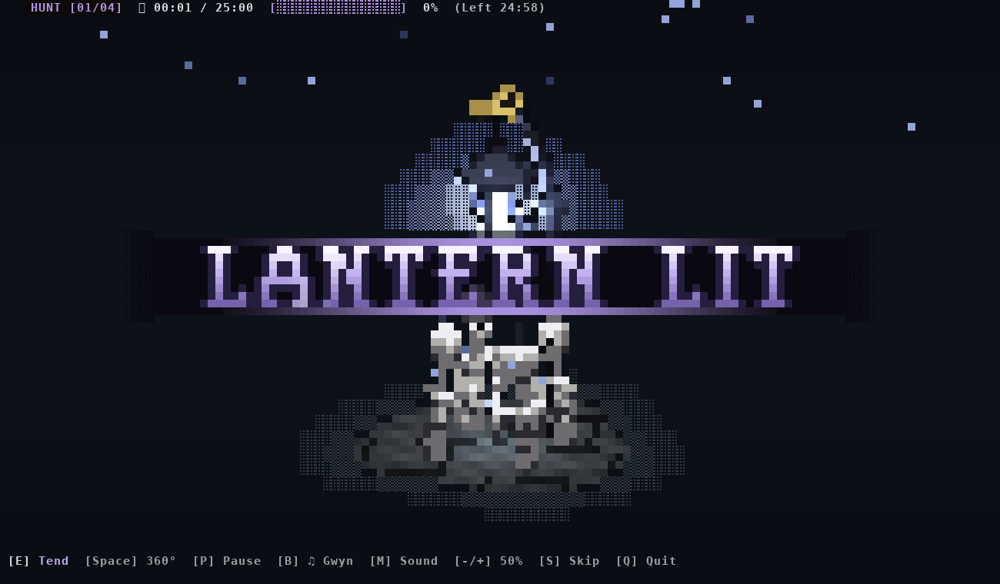
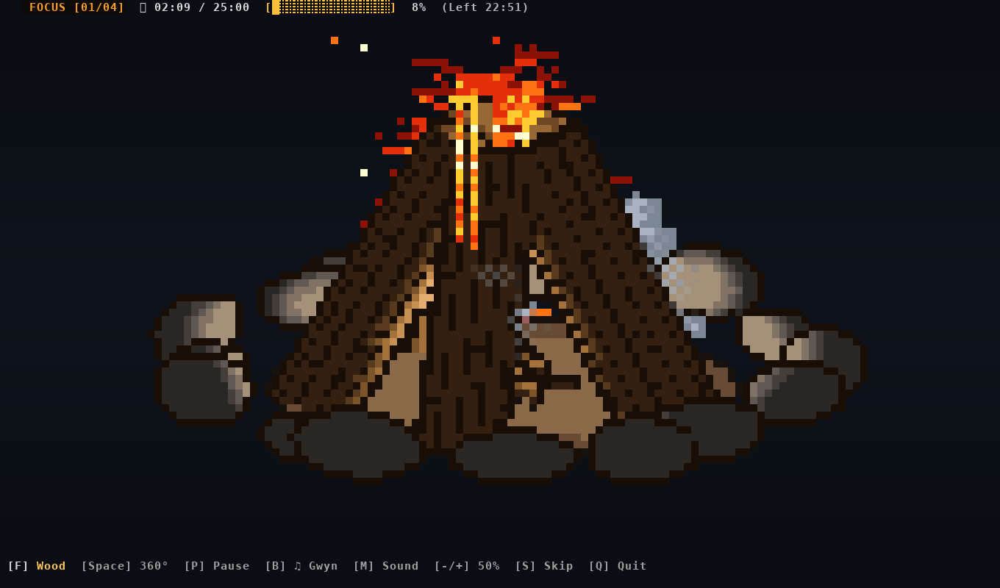

<p align="center">
  
</p>

<p align="center">
  <a href="https://github.com/GabrielBaiano/ashen-pomodoro/actions/workflows/ci.yml"></a>
  <a href="https://github.com/GabrielBaiano/ashen-pomodoro/releases/latest"></a>
  <a href="https://github.com/GabrielBaiano/homebrew-tap"></a>
  <a href="LICENSE"></a>
</p>

A 3D TrueColor ANSI Pomodoro timer for Linux and macOS terminals featuring a Dark Souls coiled-sword bonfire, a Bloodborne Hunter's Lamp, and a physical wood-burning hearth. Built as a single C99 source file with zero external dependencies beyond `libc` and `libm`.

## Three Scenes

### 1. Dark Souls Bonfire (`--souls`)
Procedural helical coiled sword embedded in a skull and ash mound ringed by weathered stones, paired with *Gwyn, Lord of Cinder* and *Firelink Shrine* lofi soundtracks.

<p align="center">
  
  
</p>

### 2. Bloodborne Hunter's Lamp (`--bb`)
Wrought-iron gallows lantern with three brass bells, spectral blue-violet glow, and Messengers emerging around the stone base when awakened.

<p align="center">
  
  
</p>

### 3. Classic Wood Fireplace (`--classic`)
Physical wood combustion simulation with convective cellular automata flames, thermal diffusion along wood grain, charring, and log collapse physics.

<p align="center">
  
</p>

## Highlights

- **Kindle & Rest Cycles**: Press `[E]` to light the flame and start your focus session. When the timer completes, a chime rings, a Soulsborne Trajan-style half-block banner fades across the flames, and the fire settles into smoldering embers for your break.
- **Transparent Terminal Native**: Emits `\033[49m` sky transparency, CP437 shade halos (`░▒▓`), and DEC Mode 2026 synchronized updates for tear-free rendering over transparent terminal compositors.
- **Embedded Audio Engine**: Streams 16-bit 22.05 kHz PCM audio directly to PipeWire / PulseAudio / ALSA / macOS `afplay` user-space tools without linking SDL or OpenAL.
- **Desktop Alerts & Session Log**: Triggers `notify-send` + terminal bell on phase transitions and records completed focus sessions to `~/.bonfire_history.json`.

## Installation

### Homebrew (macOS & Linux)

```bash
brew install GabrielBaiano/tap/ashen-pomodoro
```

### One-Line Install

```bash
curl -sSL https://raw.githubusercontent.com/GabrielBaiano/ashen-pomodoro/main/install.sh | bash
```

### Arch Linux (AUR)

```bash
yay -S ashen-pomodoro
```

### Build from Source

```bash
git clone https://github.com/GabrielBaiano/ashen-pomodoro.git
cd ashen-pomodoro
make
make install
```

Ensure `~/.local/bin` is in your `$PATH`, then run `ashen` (or `bonfire`).

## CLI Usage

```bash
# Launch interactive ASHEN setup menu
ashen

# Direct launch into each scene
ashen --souls
ashen --bb
ashen --classic --wood-type carvalho

# Start already lit with custom focus duration (minutes) and soundtrack
ashen --souls --lit --time 25 --bgm gwyn

# View completed Pomodoro session history
ashen --history
```

## Keyboard Controls

| Key | Action |
| --- | --- |
| `E` / `Enter` | Kindle flame, awaken lamp, or stoke sparks (`F` adds wood in classic mode) |
| `Space` (or `g` / `t`) | Toggle continuous 360° turntable camera orbit |
| `←` `→` or `a` `d` or `h` `l` | Orbit camera yaw |
| `↑` `↓` or `w` `s` or `k` `j` | Tilt camera pitch |
| `P` | Pause / resume current Pomodoro phase |
| `S` | Skip current phase (opens confirmation prompt) |
| `B` | Cycle soundtrack (`Gwyn` -> `Firelink Shrine` -> `Crackle Only`) |
| `M` | Mute / unmute ambient audio (preserves subtle end-of-cycle chime) |
| `-` / `+` or `[` / `]` | Adjust audio volume in 10% steps |
| `R` | Reset session to unlit state |
| `Q` | Quit (opens confirmation prompt) |

## Architecture

Technical details on the 3D raymarching pipeline, thermal balance equations, and log physics are documented in [docs/architecture.md](docs/architecture.md).

## License

Licensed under the [GNU General Public License v3.0](LICENSE).
